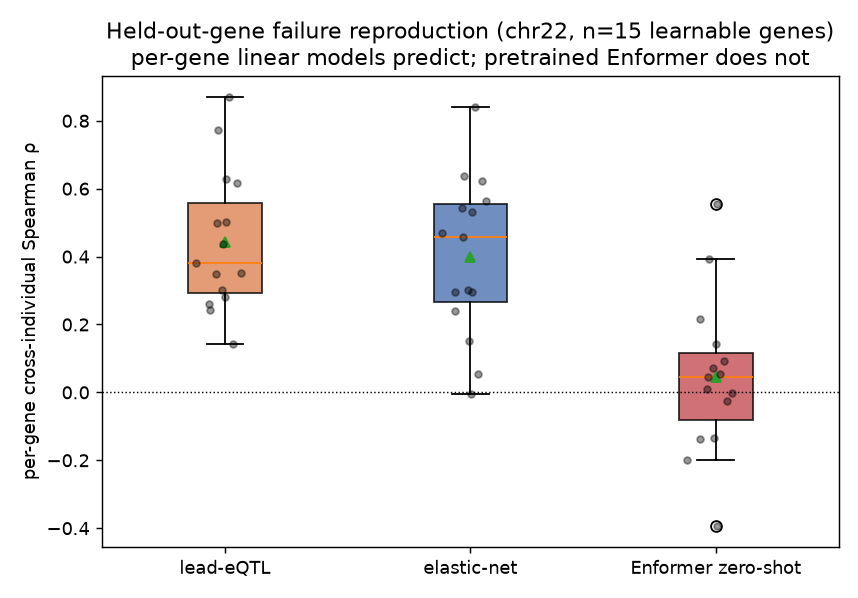

# Transferable *cis*-Regulatory Grammar for Zero-Shot Personal Expression Prediction

A  leakage-audited benchmark and mechanistic analysis of **cross-individual gene-expression
prediction on held-out genes** ... the open problem where sequence-to-expression deep models (Enformer,
Borzoi) fail. Built on fully open data (GEUVADIS + 1000 Genomes, GRCh38), end-to-end reproducible.

> **TL;DR.** Per-gene linear models predict which *people* have higher expression of a gene from their
> *cis*-variants (ρ≈0.2 on held-out individuals, robust to ancestry correction). Pretrained Enformer,
> zero-shot, does **not** (ρ≈0.05, and it gets the *direction* of variant effects wrong ~half the time). We
> reproduce this failure on clean chromosome splits, show it is genome-wide and holds across ancestries, test
> three gene-agnostic transfer models (none closes the gap), and pinpoint the mechanism: Enformer barely
> responds to most variants but is directionally correct (~70%) for the few high-impact variants where it does.

---

## Key results

| Result | Finding | Figure |
|---|---|---|
| **Failure reproduction (Gate A)** | linear ρ≈0.4 ≫ Enformer zero-shot ρ≈0.05 on held-out genes | `results/phase5_failure_reproduction.png` |
| **Transferable model (zero-shot)** | gene-agnostic motif model: ρ≈0 (does not transfer) | `results/phase6_transfer_zeroshot.png` |
| **Few-shot** | ρ scales with k (~40–80 labels → ρ≈0.2); transfer prior ≈ random | `results/phase6b_fewshot.png` |
| **Enformer-feature prior** | Enformer-ISM feature also fails to transfer | `results/phase6c_enformer_prior.png` |
| **Cross-ancestry portability** | EUR→AFR drop of 72–79% (p<1e-5) | `results/phase7_cross_ancestry.png` |
| **Cross-chromosome robustness** | reproduction cell consistent across chr22/5/11/16; Gate A replicates on chr5 | `results/phase8a_multichrom.png`, `results/phase8b_chr5_gateA.png` |
| **Direction-of-effect (mechanism)** | Enformer sign-agreement 49.7% overall (chance) but 69.6% for high-confidence variants | `results/phase9_direction.png` |
| **Negative controls** | permutation → ρ≈0 (pass); cis robust to sub-pop correction (linear 0.229 vs Enformer 0.057) | `results/phase10_negative_controls.png`, `results/phase10b_ancestry_corrected.png` |

Full numbers, CIs, and the paper narrative: **[`docs/RESULTS_SUMMARY.md`](docs/RESULTS_SUMMARY.md)**.
Verified bibliography: **[`docs/REFERENCES.md`](docs/REFERENCES.md)**.

The central figure (`results/phase5_failure_reproduction.png`):



---

## Why this matters

Linear / PrediXcan / TWAS models are **undefined on a gene with no training labels** — they fit one model
per gene. A model that transfers *cis*-regulatory grammar to an unseen gene zero-shot would be a
*qualitatively new capability*. We build the benchmark to test for it, honestly report that three
gene-agnostic approaches do **not** achieve it, and localize the bottleneck to the **transferability of the
learned variant-effect map** (not the feature source, and not the machinery).

---

## Repository structure

```
transferable-cis-grammar/
├── README.md                 # this file
├── METHODOLOGY.md            # the full 13-phase research plan
├── KICKOFF_PROMPT.md         # operating rules + hard rules
├── environment.yml           # bioconda CLI tools (bcftools, samtools, plink2, gcta, …)
├── requirements.txt          # Python DL/genomics stack (torch, enformer-pytorch, cyvcf2, …)
├── requirements.lock.txt     # frozen versions
├── configs/                  # data + genome-build config (YAML)
├── src/                      # all reusable logic (19 documented modules)
├── scripts/                  # one runnable script per phase (+ setup/fetch)
├── notebooks/                # thin, numbered notebooks (one per phase)
├── splits/                   # FROZEN split specs + leakage-audit report (released artifact)
├── results/                  # figures + result tables (regenerable)
└── docs/                     # per-phase lab-notebook docs + code reference + results summary + references
```

Data (GEUVADIS, 1000G, GENCODE, reference FASTA, JASPAR) is **not** shipped — it is downloaded/streamed by
the scripts. Derived matrices live in `data/` at runtime (git-ignored).

---

## Setup

```bash
# 1) Genomics CLI tools (micromamba + bioconda)
micromamba create -y -n cisgram -f environment.yml

# 2) Python stack (uv; a CUDA GPU is needed for the Enformer phases)
uv venv --python 3.11 .venv
uv pip install --python .venv/bin/python torch --torch-backend=cu124
uv pip install --python .venv/bin/python -r requirements.txt
```
Verified stack: torch 2.6 + CUDA 12.4 on an NVIDIA H100; enformer-pytorch 0.8; cyvcf2/pysam/pyfaidx/kipoiseq.
1000 Genomes genotypes are **streamed** per *cis*-window via remote `tabix` (no bulk download).

## Reproduce the full arc

```bash
bash scripts/phase0_setup_environments.sh && bash scripts/phase0_download_smoke_data.sh
.venv/bin/python scripts/phase1_build_targets.py            # centered cross-individual targets
.venv/bin/python scripts/phase2_validate_sequences.py       # personal haplotype construction
.venv/bin/python scripts/phase3_cis_heritability.py         # cis-h² ceiling + learnable genes
bash scripts/phase4_fetch_paralogs.sh
.venv/bin/python scripts/phase4_build_splits.py             # chromosome splits + homology audit
.venv/bin/python scripts/phase5_linear_baselines.py         # lead-eQTL / elastic-net
.venv/bin/python scripts/phase5_enformer_zeroshot.py 15     # Enformer zero-shot (Gate A)
bash scripts/phase6_fetch_motifs.sh
.venv/bin/python scripts/phase6_transfer_model.py           # gene-agnostic transfer model (zero-shot)
.venv/bin/python scripts/phase6b_fewshot.py                 # few-shot k-vs-ρ
.venv/bin/python scripts/phase6c_enformer_prior.py          # Enformer-ISM feature
.venv/bin/python scripts/phase7_cross_ancestry.py           # EUR→AFR portability
.venv/bin/python scripts/phase8a_multichrom_robustness.py   # cross-chromosome robustness
.venv/bin/python scripts/phase8b_enformer_chr5.py 15        # Gate A on chr5
.venv/bin/python scripts/phase9_direction_of_effect.py      # direction-of-effect mechanism
.venv/bin/python scripts/phase10_negative_controls.py       # permutation + ancestry-only controls
.venv/bin/python scripts/phase10b_ancestry_corrected.py     # sub-population correction (pure-cis)
.venv/bin/python scripts/phase10c_enformer_corrected.py     # matched Enformer on corrected target
```

Each phase writes to `results/` and is documented in `docs/PHASE*.md`.

---

## Documentation

Every phase has a detailed lab-notebook record under [`docs/`](docs/) (see [`docs/README.md`](docs/README.md)):
methodology, exact commands, result tables, caveats, and reproduction. Start with
[`docs/RESULTS_SUMMARY.md`](docs/RESULTS_SUMMARY.md). Citations are verified in
[`docs/REFERENCES.md`](docs/REFERENCES.md).

## Data & licensing

- **GEUVADIS** LCL RNA-seq (E-GEUV-1) — open. **1000 Genomes** high-coverage phased VCFs (GRCh38, NYGC) — open.
- **MAGE** (Zenodo 10535719, CC-BY-4.0) — for the full 26-population ancestry axis (v2).
- **GTEx** genotypes are dbGaP-controlled and are **not** used.
- **GENCODE v44**, **Ensembl GRCh38**, **JASPAR** — open.

#
## License

Code released under the **MIT License** (see `LICENSE`). Data are governed by their respective sources'
licenses.
